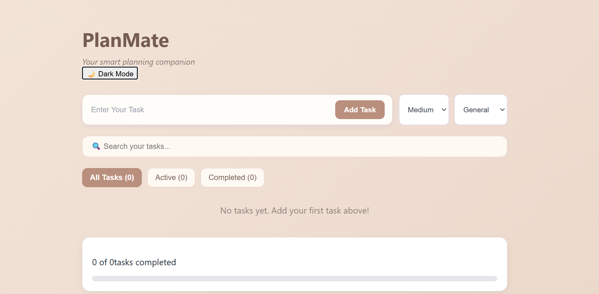
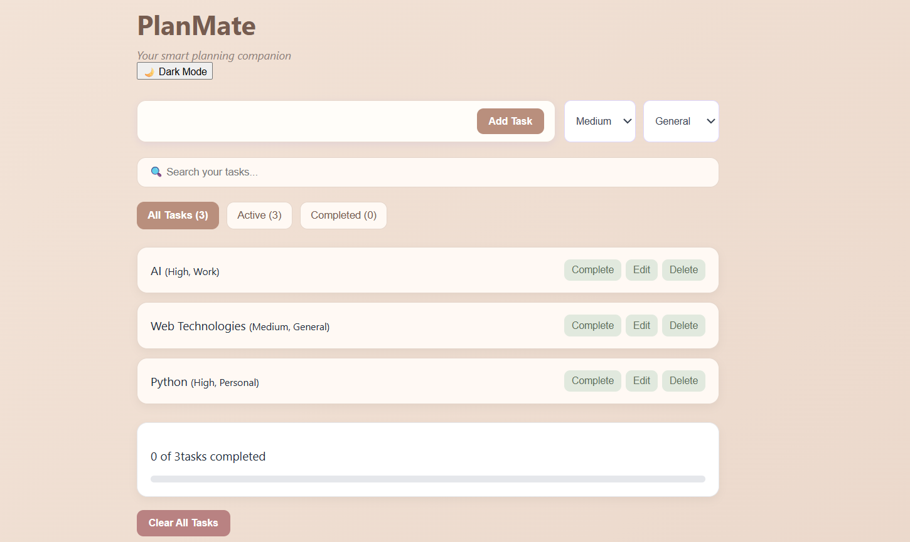
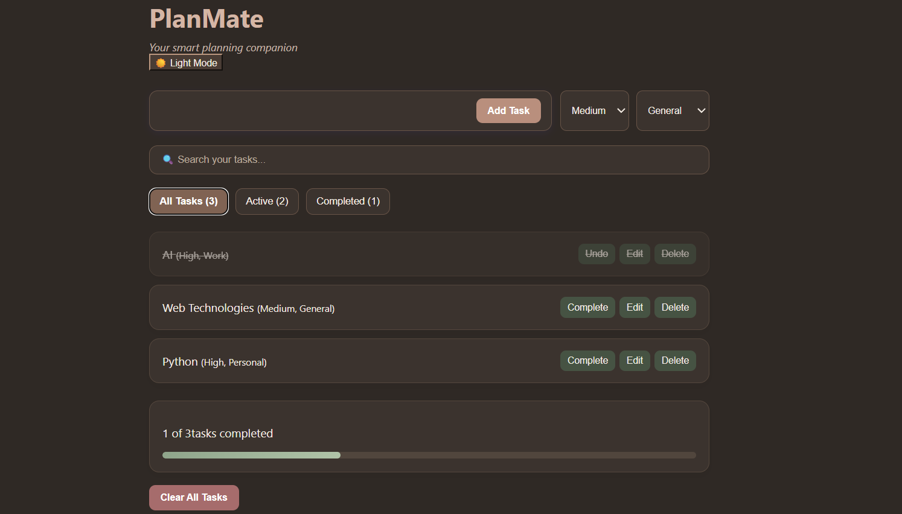

# PlanMate — Your Smart Planning Companion

PlanMate is a task management web application built with React and Vite. It helps users organize their daily tasks, track progress, and manage their work through a clean, responsive interface.

## Features

- **Task Management:** Add, edit, delete, and complete tasks.
- **Priority & Categories:** Organize tasks by priority and category.
- **Search:** Find tasks quickly using the search bar.
- **Task Filters:** View all, active, or completed tasks.
- **Progress Tracking:** Monitor completed tasks and overall progress.
- **Dark Mode:** Switch between light and dark themes.
- **Success Notifications:** Receive feedback when tasks are added, updated, completed, or deleted.
- **Local Storage:** Keep tasks saved in the browser across refreshes.

## Technologies Used

- React
- JavaScript
- HTML5
- CSS3
- Vite
- Git and GitHub

## Getting Started

### Prerequisites

Install [Node.js](https://nodejs.org/) and npm.

### Installation

1. Clone the repository:

   ```bash
   git clone https://github.com/eshwari-070/PlanMate.git
   ```

2. Open the project folder:

   ```bash
   cd PlanMate
   ```

3. Install dependencies:

   ```bash
   npm install
   ```

4. Start the development server:

   ```bash
   npm run dev
   ```

5. Open the local URL shown in your terminal.

## Project Structure

```text
PlanMate/
├── public/
├── src/
│   ├── Components/
│   │   ├── Progresstracker.jsx
│   │   ├── Taskform.jsx
│   │   └── Tasklist.jsx
│   ├── App.jsx
│   ├── Style.css
│   └── main.jsx
├── index.html
├── package.json
└── vite.config.js
```

## Data Storage

PlanMate uses browser local storage to retain tasks and the selected theme on the same browser.

## Future Improvements

- Task reminders
- Cloud synchronization
- User authentication

## Author

**Eshwari H N**

GitHub: [eshwari-070](https://github.com/eshwari-070)

---

*PlanMate — Plan better. Stay organized. Make progress.*


## Screenshots

### Main Dashboard


### Task Management


### Dark Mode

